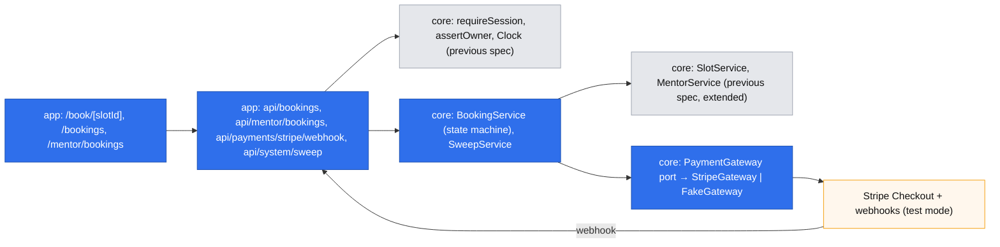
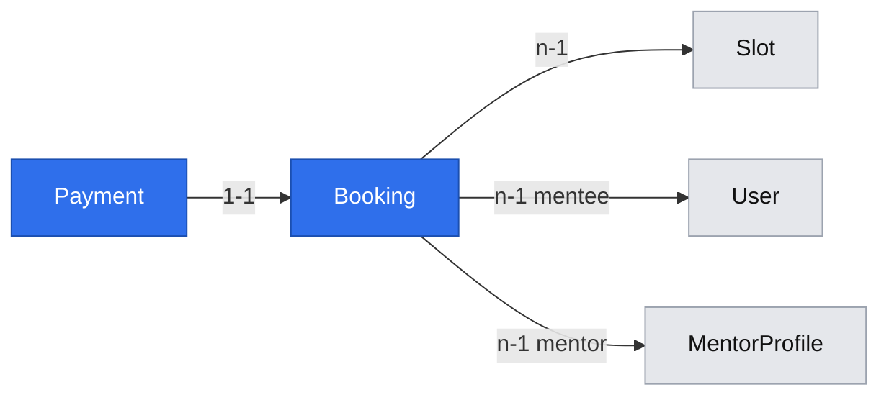

# Booking and prepayment

## 📝 TLDR
Future behavior: a signed-in developer opens a mentor (share link or public list), picks a bookable slot and a length, writes the question, pays through Stripe Checkout, and sees the booking awaiting the mentor; the mentor accepts or declines the question until 12 hours before the session, and a decline or a missed deadline refunds the mentee in full. Today mentors can publish an offer (spec `2026-10-19-mentor-accounts-and-offer.md`), but nothing can be booked or paid. This spec covers backlog #29, #30, #31, #32 (epic #22) and reuses that spec's sessions, ownership guards, `Clock`, `SlotService`, `Slot.status`, `MentorCard`/`SlotList` and constants.

## 📝 Problem Statement
A developer who found a mentor still cannot reserve their time: there is no booking, no prepayment, and no way for the mentor to see the question before committing (Key flow steps 3–4; R01, R03, R05; D05, D07). Mentors asked to see the question first (D05, `[INTERVIEW]`), and mentors and mentees asked for opposite money protections (D04). So a booking must carry the question, take the money up front, and return it automatically whenever the mentor does not take the session.

## 📝 Proposed Solution
Four phases (see Phasing): a payment gateway behind a core port (#31); booking with a held slot and Stripe Checkout (#30, plus the *Book* action of #29); mentor acceptance, deadlines and refunds (#32); the stack-tag filter and entry-point recording (rest of #29).

Gate decisions (owner Arkadiusz, 2026-10-19), recorded as D13–D15 in the brief:
- **D13** — slots are bookable only from **24 h** ahead (supersedes D09), so the mentor always has ≥ 12 h to accept under R05.
- **Payment** — Stripe Checkout (hosted page), captured at once, confirmed by webhook; refunds through the API.
- **Hold** — a new booking holds its slot for 30 minutes while the mentee pays.
- **Deadlines** — read-time evaluation plus an idempotent, secret-protected sweep endpoint called every 5 minutes by an external scheduler.
- **D14** — the platform's Stripe account collects the full price; mentor payouts and Stripe Connect are a later spec (Q01, Q05 open).
- **D15** — mentors learn about bookings in the app only; email is a later spec.
- **The question** — plain text, ≤ 2,000 characters, no attachments, visible only to that mentee and that mentor.

Alternatives considered:
- **Embedded Payment Element** — lost: card UI on our pages, more code and PCI surface for no user gain at this stage.
- **Authorize at booking, capture on acceptance** — lost: card authorizations lapse after about 7 days and slots can be 60 days ahead; refunds are simpler and always possible.
- **In-process timer** for deadlines — lost: breaks with restarts and several instances. **Read-time only** — lost: a booking nobody opens would never be refunded.
- **Stripe Connect now** — lost: every mentor would have to onboard to Stripe before a first booking, which one interviewed mentor refused (Q05).

## 🔍 Research — what market leaders do
- **Cal.com (open source)** creates the booking first, then a Stripe payment; an unpaid booking is cancelled after a timeout, and webhooks move it to accepted. It also has "requires confirmation" events, where the host confirms and a rejection refunds. Kept: the same order (booking → payment → webhook), the host-confirmation step (our R05) and refund-on-reject. Skipped: payment apps per event type, rescheduling, seat-based events.
- **Preply** confirms instantly and protects tutors with the 12-hour cancellation rule (our R04, a later spec). Its free cancellation is mentee-driven; ours adds the mentor's right to decline the question, which none of the benchmarks offer and which our mentors asked for (D05).
- **Stripe's own guidance** for Checkout: fulfil on the `checkout.session.completed` webhook, never on the success redirect; make fulfilment idempotent; use idempotency keys on refunds. Adopted as written.

## 📝 Architecture
New concepts: `bookings` and `payments`. Reused: `auth` guards, `Clock`, `SlotService`, `MentorService` (from the previous spec).

Takeaway: every money and state transition happens in `BookingService`; Stripe sits behind a port, so tests and local development run without Stripe, and a future provider or Connect changes one adapter.

**Booking state machine** (the only place statuses change; each transition runs in a transaction that locks the booking row and is a no-op when the booking is already past that state — webhooks and the sweep may repeat):

| From | Event | To | Side effects |
|---|---|---|---|
| — | mentee books an open, bookable slot | `pending_payment` | slot `open → booked` (row lock); `holdExpiresAt = now + 30 min`; Checkout session created after commit |
| `pending_payment` | webhook `checkout.session.completed` (paid) | `awaiting_acceptance` | payment `paid`; `acceptBy = slot.startsAt − 12 h` (R05) |
| `pending_payment` | hold expired (sweep, or webhook `checkout.session.expired`) | `payment_expired` | slot `booked → open`; Checkout session expired via API |
| `payment_expired` | late `checkout.session.completed` | `payment_expired` | refund in full (paid after the hold was released) |
| `awaiting_acceptance` | mentor accepts before `acceptBy` | `confirmed` | — |
| `awaiting_acceptance` | mentor declines | `declined` | refund in full; slot `booked → open` (if still ≥ 24 h ahead it is bookable again) |
| `awaiting_acceptance` | `acceptBy` passed (sweep) | `expired` | refund in full; slot `booked → open` |

Cancellation and no-show (R04) are the session spec's transitions out of `confirmed` (#34, #35).

**Reads are always correct before the sweep runs:** `BookingService.effectiveStatus(booking, now)` reports `awaiting_acceptance` past `acceptBy` as `expired` and `pending_payment` past `holdExpiresAt` as `payment_expired`; actions check the same rule (accepting after `acceptBy` → `conflict`), so the sweep only performs the side effects (refunds, slot release).

**PaymentGateway port** (`core/src/services/payments/payment-gateway.ts`): `createCheckout({ bookingId, amount, currency, description, successUrl, cancelUrl, expiresAt })` → `{ sessionId, url }`; `expireCheckout(sessionId)`; `refund({ paymentIntentId, amount, idempotencyKey })` → `{ refundId }`; `parseWebhook(rawBody, signature)` → typed event or `ValidationError`. `StripeGateway` uses the `stripe` package (test mode keys); `FakeGateway` keeps sessions in memory and serves a fake checkout page in development and integration tests. Which one is registered is decided in `container.ts` from `PAYMENTS_PROVIDER` (`stripe` | `fake`; `fake` is refused when `NODE_ENV=production`).

**Webhook route.** `POST /api/payments/stripe/webhook` reads the raw body and verifies the Stripe signature; it cannot carry the CSRF header, so `apiHandler` gains an option `{ csrf: false }` allowed only for signature-verified routes (a reviewed change to a shared primitive). It returns `200` for handled and ignored event types, and `400` for an invalid signature.

**Sweep.** `POST /api/system/sweep` (header `x-sweep-token` = `SWEEP_SECRET`, compared in constant time, plus the CSRF header) runs `SweepService`: expire holds, expire unaccepted bookings, retry `refund_pending` payments. Each item is processed in its own transaction, at most 100 per call, and is idempotent. The scheduler is outside the app: a host cron line (`curl -X POST …` every 5 minutes) documented in README; in development and tests the sweep is called directly.

**Reused and extended from the previous spec:** `SlotService.assertBookable(slotId)` (open ∧ starts ≥ now + 24 h) and `MentorService.priceFor(mentorId, lengthMinutes)` (server-side price in grosze) — both deliberately left to this spec; `SlotService.release(slotId)`.

## 📝 Data Model
- **Booking** (new, `bookings`, concept `bookings`): `slot` → Slot (n-1), `mentee` → User (n-1), `mentor` → MentorProfile (n-1, denormalized for the mentor's list), `lengthMinutes` (25 | 50, R01), `priceAmount` (integer grosze, computed server-side at booking — a later price change never touches it, per the #30 requirement), `currency` (`PLN`), `question` (text ≤ 2,000), `status` (`pending_payment | awaiting_acceptance | confirmed | declined | expired | payment_expired`), `holdExpiresAt`, `acceptBy` (nullable until paid), `entryPoint` (`link | list | unknown`, the A04 measurement), `decidedAt` (nullable). Index `(status, accept_by)`, `(status, hold_expires_at)`. Partial unique index on `slot_id` where `status in ('pending_payment','awaiting_acceptance','confirmed')` — the database guarantees one live booking per slot, written by hand in the migration.
- **Payment** (new, `payments`, concept `payments`): `booking` → Booking (1-1, unique), `provider` (`stripe | fake`), `checkoutSessionId` (unique), `paymentIntentId` (unique, nullable until paid), `amount`, `currency`, `status` (`pending | paid | refund_pending | refunded | expired`), `refundId` (nullable), `paidAt`, `refundedAt`, `lastError` (nullable, provider message only).
- **Slot** (existing): no schema change; `status` `booked` now means "held or taken by a live booking".

Interactive view (delivered with this spec): `.ai/data-model/2026-10-19-booking-and-prepayment.html`.

Sensitive data: no card data ever reaches DevMentor (Checkout). The question may contain a developer's code: it is returned only to that mentee and that mentor (`assertOwner` on either side; admins are not exempt) and never logged; Stripe receives only the amount, the currency, a generic description ("DevMentor session, 25 min") and `bookingId` metadata.

## 📝 API Contracts
Envelope and CSRF as everywhere. Amounts in grosze.

| Method + path | Access | Body → result | Notes |
|---|---|---|---|
| `GET /api/mentors?tag=` | public | `Page<PublicMentorDto>` | extends the previous spec with a `MENTOR_TAGS` filter |
| `POST /api/bookings` | mentee session | `{ slotId, lengthMinutes, question, entryPoint }` → `{ bookingId, checkoutUrl }` (201) | price from `priceFor`, never from the client; slot locked; a mentor cannot book their own slot (`forbidden`) |
| `GET /api/bookings` | mentee session | `Page<BookingDto>` (own) | effective status |
| `GET /api/bookings/[id]` | the mentee or the mentor of that booking | `BookingDto` incl. question | `assertOwner` either side, otherwise `not_found` (does not reveal existence) |
| `GET /api/mentor/bookings` | mentor session | `Page<MentorBookingDto>` | awaiting first, ordered by `acceptBy` |
| `POST /api/mentor/bookings/[id]/accept` · `/decline` | mentor (own) | → `BookingDto` | after `acceptBy` → `conflict` "The acceptance deadline has passed" |
| `POST /api/payments/stripe/webhook` | Stripe signature | raw event → `{ received: true }` | `csrf: false`; idempotent |
| `POST /api/system/sweep` | `x-sweep-token` | → `{ holdsExpired, bookingsExpired, refundsRetried, failed }` | idempotent, bounded |

New error: `PaymentUnavailableError` (503, code `payment_unavailable`) when Stripe cannot create a session — added to the `BACKWARD_COMPATIBILITY.md` error-code registry (additive). New env (additive; `env.ts`, `.env.example`, README, CI and integration setup in the same PR): `PAYMENTS_PROVIDER`, `STRIPE_SECRET_KEY`, `STRIPE_WEBHOOK_SECRET` (required when the provider is `stripe`), `SWEEP_SECRET` (≥ 32 chars), `APP_URL` (success and cancel URLs).

## 📝 UI/UX
- **Mentor page `/m/[slug]` and list `/mentors`** (previous spec): each bookable slot gets *Book 25 min · {price}* and *Book 50 min · {price}*; the list gains a stack-tag filter. Links from the list carry `from=list`; the share link is `link`.
- **`/book/[slotId]?length=…`** (mentee): a summary (mentor, local date and time with zone, length, price), the question box with a counter, and a reminder that the mentor sees the question and may decline it (refund in full). An anonymous visitor goes to `/login?next=…` (or *Register*) and comes back. *Pay* opens Checkout.
- **`/bookings/[id]`** (mentee): Checkout returns here. *Payment processing…* until the webhook lands (the page re-checks every few seconds, up to a minute, then says it will update shortly); then *Waiting for {mentor} — they decide by {acceptBy}*; *Confirmed*; *Declined — refunded*; *Expired — refunded*; *Payment not completed — the time was released*. Refund wording says that banks take a few days.
- **`/bookings`** (mentee): own bookings by status.
- **`/mentor/bookings`** and a *Pending* item on `/mentor`: each awaiting booking shows the question, the slot and a countdown to `acceptBy`, with *Accept* and *Decline* (a confirm step for decline: "The mentee gets a full refund").

## 📝 Edge Cases & Failure Scenarios
- **Two mentees, one slot:** the slot row lock plus the partial unique index let exactly one booking through; the other gets `conflict` "This time was just taken".
- **Stripe unavailable when creating Checkout:** the booking and hold are rolled back by a compensating transaction (slot `open` again); the mentee sees "Payment is temporarily unavailable, try again" (`payment_unavailable`). No charge happened.
- **Mentee abandons Checkout:** the hold expires after 30 min (sweep or `checkout.session.expired`); the slot is bookable again.
- **Paid after the hold expired** (late webhook): refund in full at once; the booking stays `payment_expired`; the page explains it.
- **Webhook delivered twice or out of order:** transitions are idempotent and ignore events for a booking already past that state; unknown event types return `200` and are ignored.
- **Webhook never arrives:** the booking stays `pending_payment` and the hold expires into `payment_expired`; if Stripe did take the money, the next webhook retry (Stripe retries for days) triggers the late-payment refund. Logged with `bookingId` for support.
- **Refund fails** (Stripe error): the payment goes to `refund_pending` with `lastError`; the sweep retries with the same idempotency key (`refund:{bookingId}`), so it can never refund twice. After 24 h of failures it logs an error for the founders.
- **Mentor accepts and declines at once (two tabs):** the booking row lock serializes them; the second gets `conflict`.
- **Accept at the deadline:** `now ≥ acceptBy` → `conflict`, even if the sweep has not run.
- **Booking own slot / mentor role booking:** a mentor may book other mentors as a mentee; booking one's own slot → `forbidden`.
- **Mentor deletes a slot with a live booking:** already refused by the previous spec (`conflict`).
- **Sweep not scheduled or failing:** reads stay correct, but refunds and slot releases wait; the sweep response and logs count `failed`, and README states the cron line is required in any deployed environment.
- **Price changed after booking:** the booking keeps `priceAmount`; refunds use the payment amount.

## 📝 Risks & Impact Review
- **Money (risk-high):** prepayments and refunds; QA and a second reviewer required (`SDLC.md`), no self-QA. Test mode only until Q01 (commission) and the payout spec exist — **not launchable** on its own: collected money sits on the platform account (D14).
- **Hard to reverse:** `bookings` and `payments` tables, the partial unique index, the `payment_unavailable` code, the webhook URL registered in Stripe.
- **Shared primitive change:** `apiHandler({ csrf: false })` could weaken CSRF if misused; the option is accepted only together with signature verification, and a unit test plus a code-review rule check it.
- **Operational dependency:** an external scheduler must call the sweep; without it refunds are delayed (not lost).
- **Product limitation (D13, D15):** the nearest bookable slot is ≥ 24 h away; mentors who do not open the app lose bookings to expiry. Both are measured by `entryPoint`, booking-to-start time and the expiry rate.
- **Dependency:** `stripe` (official SDK) in `@devmentor/core`.

## 📝 Decisions in play
Relied on: R01, R03 (prepayment via Stripe), R05 (accept/decline until 12 h before; expiry and decline refund in full), R07 (mentor price; commission open — Q01), R08, D02, D03, D05, D07, D08, D10–D12, N02, N03. Introduced at this gate (owner Arkadiusz): **D13** (supersedes D09), **D14**, **D15** — recorded in `product-brief.md` and `research/decisions/`. Out of scope and owned by later specs: cancellation and no-show (R04, #34, #35), mentor payouts and commission (Q01, Q05, D14), email notifications (D15).

## 📋 Phasing
1. **Payment gateway** (#31) — port, Stripe and fake adapters, webhook parsing, env; no user-visible change, fully unit-tested.
2. **Booking and prepayment** (#30, *Book* action of #29) — depends on 1: booking with a held slot, Checkout, webhook, hold expiry in the sweep, mentee pages.
3. **Acceptance and refunds** (#32) — depends on 2: accept/decline, `acceptBy` expiry, refunds and refund retries in the sweep, mentor pages.
4. **Filter and entry point** (rest of #29) — depends on 2: stack-tag filter and `entryPoint` recording.

## 📋 Implementation Plan

### Phase 1 — Payment gateway (#31)
1. Env: `PAYMENTS_PROVIDER`, `STRIPE_SECRET_KEY`, `STRIPE_WEBHOOK_SECRET`, `APP_URL` in `env.ts` (conditional requirement, `fake` refused in production), `.env.example`, README, CI; redaction of `STRIPE_*`.
2. `PaymentGateway` port, `FakeGateway`, `StripeGateway` (`stripe` SDK, mocked client in unit tests), container registration by provider; `PaymentUnavailableError` + registry update. 100% coverage.

### Phase 2 — Booking and prepayment (#30)
1. `Booking`, `Payment` entities + migration with the hand-written partial unique index (reviewed SQL).
2. `SlotService.assertBookable`, `SlotService.release`, `MentorService.priceFor`; `BookingService.create` (slot lock, price, hold) with the compensating rollback; unit tests incl. concurrency rules with a fake clock.
3. `apiHandler({ csrf: false })` with its guard test; webhook route; `BookingService.markPaid` / late-payment refund; `SweepService` (hold expiry) and `/api/system/sweep` with `SWEEP_SECRET`.
4. `/api/bookings*`, `/book/[slotId]`, `/bookings`, `/bookings/[id]`, *Book* buttons on `/m/[slug]`; the fake checkout page served only by `FakeGateway`. Integration test (fake provider): book → pay → *Waiting for mentor*; abandon → sweep → slot bookable again; two parallel bookings → one wins. Screenshots.

### Phase 3 — Acceptance and refunds (#32)
1. `BookingService.accept` / `decline` / `expireUnaccepted`, `effectiveStatus`; refunds with idempotency keys; `refund_pending` retries in the sweep. Unit tests for every transition in the table, including repeats.
2. `/api/mentor/bookings*`, `/mentor/bookings`, the *Pending* item on `/mentor`. Integration test: mentor accepts → *Confirmed*; another booking declined → refunded and slot reopened; a third left past `acceptBy` (fake clock) → sweep → *Expired — refunded*. Screenshots.

### Phase 4 — Filter and entry point (#29)
1. `?tag=` on `GET /api/mentors` and the filter on `/mentors`; `entryPoint` passed from the list (`from=list`) or the share link. Integration test: filter narrows the list; a booking from the list records `list`. Screenshot.

Done for the spec: four phases merged; lint, typecheck, `test:coverage` (100%), build and integration tests green; a manual run against Stripe test mode with the Stripe CLI forwarding webhooks recorded in the PR (real-run evidence, review rule R4); #29–#32 closed.
