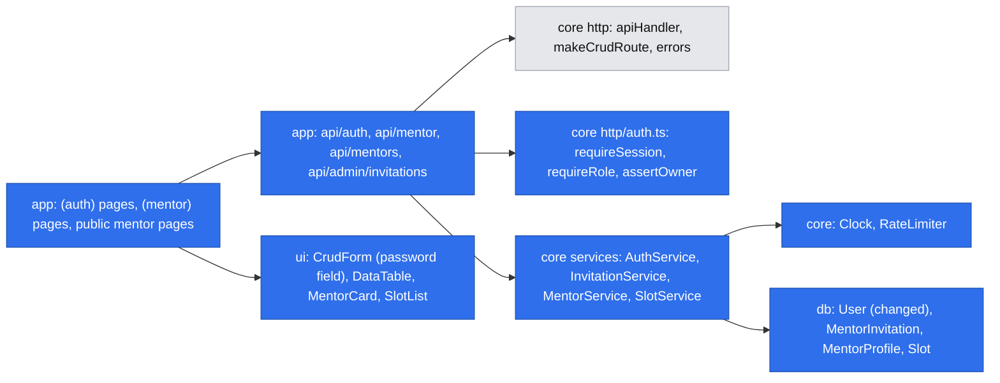
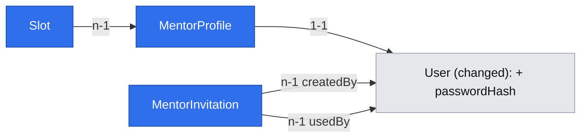

# Mentor accounts and bookable offer

## 📝 TLDR
Future behavior: a developer can register and sign in with email and password; a senior engineer invited by the founders can register as a mentor, set prices for 25- and 50-minute text sessions, publish bookable slots, and share a personal link to that offer, optionally appearing on a public list. Today the app has only an admin user CRUD guarded by a temporary `requireAdmin()` that is open in development; nobody can sign in. This spec covers backlog #26, #25, #27, #28 (epic #21) and builds once the foundations that booking (#29–#32) and sessions (#33–#36) reuse: sessions and ownership checks, money and slot-time rules, and the mentor and slot read models.

## 📝 Problem Statement
Developers stuck on a specific problem want a written answer from someone whose public work shows they have done it (brief Goals, `[INTERVIEW]`); senior engineers already help unpaid (Target group, `[INTERVIEW]`). Nothing can be booked until a mentor exists as an authenticated account with prices and slots (Key flow step 1; R07, R08, D03). The repo has no identity: `users.role` exists, but no one can sign in, and every later story needs a session, a role and a per-record ownership check (`engineering-standards.md` — "ownership over role"). Building those per feature would duplicate security-critical code, so they are specified here once.

## 📝 Proposed Solution
Four phases, each shippable on its own (see Phasing):

1. **Accounts and sessions (`auth`)** — email + password registration for mentees, login/logout, a signed session cookie, and `requireSession` / `requireRole` / `assertOwner` replacing the temporary guard.
   **1b. Mentor invitations (`mentors`)** — mentor registration only through a founder-issued invitation link (creates the User only).
2. **Mentor profile and prices (`mentors`)** — profile (name, headline, bio, stack tags, public-work links), the two prices in PLN, and the share slug, created on the mentor's first visit to `/mentor`.
3. **Slots (`availability`)** — a mentor publishes start times; each blocks 50 minutes; only slots starting at least 24 hours ahead are bookable (D13).
4. **Share link and public list (`mentors`)** — a public mentor page at a stable link, and a public list of opted-in, bookable mentors.

Decisions taken with the owner on 2026-10-19 (gate answers, recorded as D09–D12 below): email + password only (GitHub is a profile link, not a login); mentors join by invitation; Q02 answered — slots starting less than 12 hours ahead are not bookable in 1.0; PLN only.

Alternatives considered:
- **GitHub OAuth (or both methods)** — lost: a new provider, a callback flow and an extra dependency for a user base the founders invite by hand; the standards already define the password path. GitHub stays as a public-work link, which is what N02's rationale asks for.
- **Self-service mentor role at registration** — lost: anyone could appear as a mentor; the recruitment test (A02) needs to know who was invited and who joined.
- **Availability windows with recurrence rules** (Cal.com, Calendly) — lost for 1.0: rules, overrides and slicing are the bulk of a scheduling product; publishing explicit start times covers a mentor offering a few sessions a week.

## 🔍 Research — what market leaders do
- **Cal.com (open source) and Calendly** model availability as recurring rules plus date overrides, with *minimum booking notice*, buffers between events and calendar sync. Kept: minimum notice (our 12 h), a fixed block per slot (our 50 min acts as the buffer), UTC storage with display in the viewer's zone. Skipped: recurrence, overrides, external calendar sync, per-event buffers — each is a later, additive change on the same `slots` table.
- **Topmate** sells one expert's sessions "from a single link" and charges less commission when the buyer came through the expert's own link (benchmark note 2026-09-04). Kept: the share link as the primary entry (D03); recording the entry point is left to the booking spec (A04 measurement).
- **Codementor, MentorCruise, Preply** put star ratings on every card; our N02 excludes them. Kept instead: public-work links and stack tags on the card — the trust signal the interviews named.

## 📝 Architecture
New concepts follow the repo's concept-folder convention: `auth` (extends existing), `mentors`, `availability`.

Takeaway: routes stay thin (validation → `requireSession` → service); every rule that booking will rely on (who owns what, what is bookable, what a session costs) lives in core services.

**Sessions.** Stateless JWT (HS256, `AUTH_SECRET` ≥ 32 bytes from `env.ts`), 24 h expiry, no refresh (documented limitation), in cookie `devmentor_session` (`httpOnly`, `secure` in production, `sameSite=lax`, `path=/`). `requireSession(req)` verifies the token from the request's `Cookie` header **and reloads the user** through the request-scoped `em`, so a deleted user or changed role takes effect immediately; any failure → `UnauthorizedError` (fail closed). Core never imports `next`: it returns the token and cookie options; the app route sets the cookie with `cookies()` from `next/headers`. CSRF stays the existing `x-devmentor-client` header check plus `sameSite`.

Known limitations (accepted for 1.0, Grill Me 2026-10-19): no email verification — the system sends no email yet, and for mentors the invitation link the founder delivers stands in for it; no self-service password reset — a founder resets it with `auth:set-password`; no account deactivation — a mentor hides by unlisting and deleting slots (the share link then shows "No times available"); no self-service account deletion — tied to brief Q04 (terms and data processing); passwords are 12–128 characters with no composition rules; sessions last 24 h with no refresh (standards). Logout clears the cookie but a copied token stays valid until it expires (≤ 24 h) — `requireSession` reloading the user limits the damage to the account's own data; no refresh token.

**Guards.** `core/src/http/auth.ts` exports `requireSession(req)`, `requireRole(session, ...roles)` (throws `ForbiddenError`) and `assertOwner(ownerUserId, session)` (throws `ForbiddenError`; admins are not exempt for mentor-owned writes). `requireAdmin` becomes `requireSession` + `requireRole("admin")` in **every** environment — the dev-open behavior is removed. Refactor of an existing contract: `makeCrudRoute`'s `accessGuards` changes from `Record<Access, () => void>` to `Record<Access, (req: Request) => Promise<Session>>`; the only consumer is `api/users/users.crud.ts`, updated in the same step.

**Rate limiting.** Key = normalized email + client IP, where the IP is the first entry of `x-forwarded-for` (the app runs behind one reverse proxy in Docker), falling back to `"unknown"`. The header can be spoofed when the app is exposed directly, so the email part of the key is what reliably caps guessing on one account. The limiter reads time from `Clock`.

**Where the UI gets domain values.** `@devmentor/ui` cannot import `@devmentor/db` or `@devmentor/core` (ESLint). Constants live in `db/src/constants.ts` for validators and services; the UI receives them in DTOs (`currency`, prices in grosze, slot `startsAt`/`endsAt`) and in props. `formatPrice(minor, currency)` lives in `ui/src/lib/` and takes the currency as an argument.

**Reusable foundations for later specs.**

| Foundation | Lives in | Reused by |
|---|---|---|
| `requireSession`, `requireRole`, `assertOwner`, `Session` type | `core/src/http/auth.ts` | every authenticated route (#29–#36) |
| `RateLimiter` (in-memory, per key, attempts + cooldown, reads `Clock`) | `core/src/http/rateLimit.ts` | login, register; later any abuse-prone endpoint |
| `Clock` (`now(): Date`) in the cradle | `core/src/services/system/clock.ts` | rate limiter (Phase 1), slot visibility (Phase 3), acceptance deadline (R05), cancellation window (R04) |
| Constants: `SESSION_LENGTHS = [25, 50]`, `SLOT_BLOCK_MINUTES = 50`, `BOOKING_LEAD_TIME_HOURS = 24` (D13), `CURRENCY = "PLN"`, `MENTOR_TAGS` | `db/src/constants.ts` (client-safe, for validators and services; the UI gets values through DTOs) | validators, booking, cancellation |
| `SlotService.listBookable(mentorId)` — one definition of "bookable" (open ∧ starts ≥ now + 24 h, D13) | `core/src/services/availability/` | public pages (Phase 4), finding a mentor (#29); booking (#30) adds `assertBookable` on the same service |
| `Slot.status` (`open` / `booked`) + unique `(mentor, starts_at)` | `db/src/entities/availability/` | booking flips `open → booked` in a transaction (idempotency rule); created now so #30 needs no migration on `slots` |
| `MentorCard`, `SlotList` (grouped by day, viewer's local time with zone label), `formatPrice(minor, currency)` | `ui/src/components/mentors/`, `ui/src/components/availability/`, `ui/src/lib/` | public list, #29 search, booking pages |

Deliberately left to the booking spec (no consumer here): `MentorService.priceFor` (server-side price for prepayment) and `SlotService.assertBookable`.

## 📝 Data Model
All tables use `baseProperties()` (UUID, timestamps). Money in integer grosze. Times are `timestamptz`, stored in UTC.

- **User** (changed, `users`): add `passwordHash` (string, nullable — existing admin-created rows have none and cannot log in; `npm run auth:set-password -- --email <e>` sets or resets a password for any existing email without changing its role; the admin user CRUD never handles passwords). Email is already unique and normalized. `role` keeps `mentor | mentee | admin`; registration sets `mentee`, invitation sets `mentor`.
- **MentorInvitation** (new, `mentor_invitations`, concept `mentors`): `email` (normalized), `tokenHash` (SHA-256 of a 32-byte random token; the token itself is shown once and never stored), `expiresAt` (14 days), `usedAt` (nullable), `createdBy` → User (n-1), `usedBy` → User (n-1, nullable).
- **MentorProfile** (new, `mentor_profiles`, concept `mentors`): `user` → User (1-1, unique; the mentor's name is `User.name`, editable on the profile page — no separate display name), `headline` (≤ 120), `bio` (≤ 2,000, plain text), `tags` (subset of `MENTOR_TAGS = TypeScript, React, Python, AI agents`), `links` (JSON array, ≤ 5 `https` URLs), `price25` and `price50` (integer grosze, nullable until set), `shareSlug` (unique; slug of `User.name` + 6 random characters, generated when the profile is created, never regenerated or reused), `listed` (boolean, default `false` — R08 opt-in). All columns arrive in the Phase 2 migration; Phase 4 only adds the UI and queries that use `shareSlug` and `listed`. The profile is created lazily by `MentorService.getOrCreateOwn` on a mentor's first visit to `/mentor` — the same path for invited mentors and for mentees an admin promoted.
- **Slot** (new, `slots`, concept `availability`): `mentor` → MentorProfile (n-1), `startsAt` (timestamptz, minute divisible by 15), `status` (`open | booked`, default `open`). Unique `(mentor_id, starts_at)`; index `(status, starts_at)`.

Interactive view (delivered with this spec): `.ai/data-model/2026-10-19-mentor-accounts-and-offer.html`.

Prerequisite: issue #16 (register entities as `globalThis` singletons) must land before the first relation here — it is Phase 1, Step 1.

Sensitive data: `passwordHash` and `tokenHash` never leave core (DTOs omit them; the logger redacts `password`, `passwordHash`, `token`, `tokenHash`, `cookie`). Email is visible only to its owner and admins; the public mentor DTO has no email.

## 📝 API Contracts
All responses use the existing envelope; state-changing requests carry `x-devmentor-client: 1`. Shapes are DTOs, never entities.

| Method + path | Access | Body → result | Notes |
|---|---|---|---|
| `POST /api/auth/register` | public, rate-limited | `{ name, email, password }` → `SessionUserDto`, sets cookie | role `mentee`; password 12–128 chars; duplicate email → generic `conflict` message that does not confirm existence beyond the form field |
| `POST /api/auth/register/mentor` | public, rate-limited | `{ token, name, password }` → `SessionUserDto`, sets cookie | email comes from the invitation; creates the User (`mentor`) and marks the invitation used, in one transaction (the profile comes later, lazily) |
| `POST /api/auth/login` | public, rate-limited | `{ email, password }` → `SessionUserDto`, sets cookie | generic `unauthorized` "Invalid email or password" |
| `POST /api/auth/logout` | session | → `null`, clears cookie | |
| `GET /api/auth/me` | public | → `SessionUserDto \| null` | |
| `GET, POST /api/admin/invitations` | admin (= a founder, D11) | `{ email }` → `{ invitation, link }` | the link (with the raw token) is returned **only** in the POST response; `createdBy` records which founder invited |
| `GET, PUT /api/mentor/profile` | mentor (own) | profile fields + `price25`, `price50` (grosze) | `assertOwner`; prices 1,000–1,000,000 grosze (10–10,000 PLN, sanity bounds, not a business rule) |
| `GET, POST /api/mentor/slots`, `DELETE /api/mentor/slots/[id]` | mentor (own) | `{ startsAt }` (ISO UTC) → `SlotDto` | rules in Edge Cases |
| `GET /api/mentors` | public | `?page&pageSize&tag` → `Page<PublicMentorDto>` | only `listed` **and** bookable mentors (prices set, ≥ 1 bookable slot), ordered by soonest bookable slot |
| `GET /api/mentors/[slug]` | public | → `PublicMentorDto` with bookable slots | works for unlisted mentors (share link); `not_found` for unknown slug |

New error: `TooManyRequestsError` (429, code `rate_limited`). Error codes are a protected contract (`BACKWARD_COMPATIBILITY.md` §1): this addition is additive and must be added to that registry in the same PR. New env `AUTH_SECRET` is additive: update `env.ts`, `.env.example`, README, CI and the integration global setup together (§4).

## 📝 UI/UX
Public and mentor pages use Tailwind; admin pages use `@devmentor/ui` (shadcn). Forms use `CrudForm`, extended so a field declared `z.string().meta({ input: "password" })` renders `type="password"` with `autocomplete` set; lists use `DataTable`; loading, error and empty states use `feedback/`.

- **(auth)** `/login`, `/register`, `/register/mentor?token=…` — after success everyone lands on `/` in Phase 1; from Phase 2 mentors land on `/mentor`. An expired or used invitation shows that the link is no longer valid and that the mentor should ask the founders for a new one (no form shown).
- **(mentor)** `/mentor` — a checklist that drives the mentor to bookable, growing one item per phase: *profile* and *prices* (Phase 2), *at least one bookable slot* (Phase 3), *share link* and *public list* (Phase 4), each with its state, so a mentor never wonders why they are not visible. `/mentor/profile` edits profile and prices; from Phase 4 it also toggles "Show me on the public list". `/mentor/slots` lists upcoming slots grouped by day in the mentor's local time; adding a slot takes a date and time; slots inside the next 24 hours are shown as "not bookable — starts too soon".
- **Public** `/mentors` — cards (`MentorCard`): name, headline, tags, public-work links, both prices, soonest bookable slot; no ratings (N02). `/m/[slug]` — the share page: profile, prices, bookable slots (`SlotList`); the *Book* action is a disabled placeholder until #30.
- **Admin** `/admin/invitations` — create an invitation by email; the link is shown once with a copy button; list shows pending / used / expired.
- Header shows *Log in* / *Register*, or the user's name and *Log out*.

## 📝 Edge Cases & Failure Scenarios
- **Brute force:** 5 failed logins per IP + email within 15 min → 429 with a retry time; registration (both routes) is limited to 10 accounts per IP per hour. The limiter is in-memory, per process: acceptable for one container in 1.0; documented as needing a shared store before scaling out.
- **Invitation misuse:** used, expired or unknown token → one generic "This invitation is no longer valid" (no detail on which). Two parallel registrations with one token → the transaction's `usedAt IS NULL` condition lets exactly one succeed.
- **Existing email at mentor registration** (someone registered as a mentee first) → `conflict`; the admin can promote the account instead (admin user edit already sets `role`; the profile is created on the first visit to `/mentor`, as for invited mentors).
- **Slot rules (server-side, in `SlotService`, inside a transaction):** `startsAt` must be at least 24 h from now (D13) and at most 60 days ahead, on a 15-minute grid, and at least 50 minutes from any other slot of the same mentor; violations → `validation_error` with a field message. Duplicate start → unique constraint → `conflict`.
- **Concurrent slot writes:** two requests adding slots 20 minutes apart could both pass the spacing check. `SlotService.publish` first locks the mentor's `mentor_profiles` row (`LockMode.PESSIMISTIC_WRITE`, i.e. `SELECT … FOR UPDATE`) inside the transaction, then checks spacing and inserts, so one mentor's slot writes are serialized. An integration-level test fires two overlapping publishes in parallel and expects exactly one `201` and one `validation_error`.
- **Deleting a slot:** only `open` slots of the owner; a `booked` slot → `conflict` "Cancel the booking instead" (cancellation is R04, #34).
- **Slot becomes too soon:** visibility is computed at read time with `Clock` (`startsAt ≥ now + 24 h`); nothing is mutated, so there is no job to fail.
- **Time zones and DST:** the browser converts the mentor's local date-time to an ISO UTC string, using the browser's zone (`Intl.DateTimeFormat().resolvedOptions().timeZone`, shown on the form); every display shows the viewer's local time with a zone label. The mentor and mentee may see different clock times for the same slot, by design.
  - *Nonexistent local time* (spring-forward gap, e.g. 02:30 on the last Sunday of March in Europe/Warsaw): the form converts and converts back; if the round trip does not return the entered time, it refuses with "This time does not exist in your time zone".
  - *Ambiguous local time* (fall-back, 02:00–02:59 occurs twice): the browser picks the first occurrence; before saving, the form previews "Starts {weekday, date, time} ({zone}, UTC{offset})" so the mentor sees which one. No server-side zone logic.
- **Unlisted mentor:** absent from `/mentors`; `/m/[slug]` still works (R08, D03). A mentor without prices or bookable slots is listed nowhere, and their share page says "No times available right now" (empty state, not an error).
- **Deleted or demoted user with a live cookie:** `requireSession` reloads the user and fails closed.
- **Missing or short `AUTH_SECRET`:** `getEnv()` throws at container creation — the app does not start rather than signing weak tokens.

## 📝 Risks & Impact Review
- **Hard to reverse:** the `users.password_hash` column and the three new tables (migrations); the share slug format once links are shared publicly (slugs are never regenerated); the `rate_limited` error code (contract).
- **Behavior change for developers:** admin pages are no longer open in development. Integration tests and local work need a seeded admin — Phase 1 adds it to the integration global setup and a `npm run auth:set-password` script (a new root npm script: additive contract, documented in `AGENTS.md`). Coordinate with #17 (db seeder).
- **Product limitation, owner-accepted (D09, tightened by D13):** no same-day help in 1.0 — every bookable slot is at least 24 h away, which the brief's Decision summary and the synthetic panel flagged as the most likely reason urgent developers leave (A01). Measured once bookings exist.
- **Security review required:** `risk-high` (auth, sessions, money fields, migrations) — needs QA and a second reviewer per `SDLC.md`; no self-QA.
- **Dependencies:** `bcryptjs` and `jose` in `@devmentor/core` (both pure JS, no native build).

## 📝 Decisions in play
Relied on (from `product-brief.md`): R01 (25/50-min text sessions), R07 (mentor sets prices; commission is a setting — Q01 still open, so no commission is computed here), R08 (opt-in list, share link for every mentor), D01, D03, D08, N02 (no ratings), N03 (no help within the hour). R05/D07 (acceptance until 12 h before) is what makes D09 necessary.

New decisions from this spec's gate, owner Arkadiusz, 2026-10-19 — recorded in the brief and in `research/decisions/D09–D12`:

| Id | Decision | Why |
|---|---|---|
| D09 | Answers Q02: slots starting less than 12 h ahead are not bookable in 1.0 — **superseded by D13 (24 h)**, decided in the booking spec's gate | keeps R05/D07 intact; revisit with A01 data after the first bookings |
| D10 | Sign-in is email + password only in 1.0; GitHub is a public-work link on the profile | no new provider; standards already define the password path |
| D11 | Mentors register only through an invitation link issued by an admin; every admin is a founder (the first admin exists only via `auth:set-password --admin`); mentees self-register | matches the recruitment test (A02) and keeps the mentor list curated |
| D12 | Prices are in PLN only, stored in grosze | the evidence comes from a Polish developer community |

## 🔍 Review decisions
Owner decisions on the reviews, 2026-10-19:

- **Grill Me** (after both reviews): 11 questions, all recommendations accepted — the limitations listed under Architecture, `auth:set-password` replacing `auth:create-admin`, slot constants kept (60-day horizon, 15-minute grid, 50-minute spacing), public list ordered by soonest bookable slot, one name field (`User.name`), a registration limit, and a requirement handed to the booking spec: a price change applies only to new bookings, so #30 stores the price on the booking at payment time.

- **Scope-cohesion review** (fresh-context subagent, same model family): verdict *revise*; all ten findings accepted and applied — lazy profile creation so Phase 1 ships alone, `shareSlug`/`listed` in the Phase 2 migration, UI receives domain values through DTOs, `priceFor`/`assertBookable` left to the booking spec, invitations split into Phase 1b, open implementation choices stated.
- **Cross-model review** (Codex, GPT): verdict *revise*.
  - Accepted: D09 recorded in the brief (Q02 closed); guard-change consumers spelled out (integration login helper, local admin bootstrap); invitation authority defined (admins are founders, first admin only via the script); per-mentor serialization of slot writes; DST handling for nonexistent and ambiguous local times.
  - Rejected: "move research, booking foundations and the phase plan out of the spec". The shared foundations were an explicit requirement of this spec (build once for #29–#36), the research section is part of the `om-spec-writing` format, and the phase/step plan is what `om-auto-create-pr` executes. `Slot.status` stays so #30 needs no migration on `slots`.

## 📋 Phasing
1. **Accounts and sessions** (#26) — shippable alone: mentees can register and sign in, and admins are protected by a real session.
   **1b. Mentor invitations** (#26, second PR) — depends on 1; split out so the security-critical session PR is reviewed alone.
2. **Mentor profile and prices** (#25) — depends on 1b.
3. **Slots** (#27) — depends on 2 (a slot belongs to a profile).
4. **Share link and public list** (#28) — depends on 3 (only bookable mentors are listed).

## 📋 Implementation Plan

### Phase 1 — Accounts and sessions (#26)
1. Land #16 (entity `globalThis` singletons) so relations are safe; no behavior change.
2. `AUTH_SECRET` in `env.ts` (≥ 32 chars), `.env.example`, README, CI and integration setup; logger redaction list extended. Unit tests for the env schema.
3. `User.passwordHash` + migration (reviewed SQL). `Clock` and `RateLimiter` (using `Clock`) in core with unit tests (fake clock).
4. `AuthService` (register, login with bcryptjs cost 12, token issue/verify with `jose`) and `requireSession` / `requireRole` / `assertOwner`; `TooManyRequestsError`; `BACKWARD_COMPATIBILITY.md` error-code registry updated. 100% unit coverage including every fail-closed branch.
5. Refactor: `makeCrudRoute` guards take the request (`users.crud.ts` updated); `requireAdmin` rebuilt on the session; `auth:set-password` script (`--email X` sets or resets that account's password; with `--admin` it creates the account as an admin or promotes it; it runs against `DATABASE_URL`, so only someone with database access can create the first admin or reset a password). Consumers of the changed guard, in the same PR:
   - **Integration tests:** `global-setup.ts` creates an admin through the same service the script uses, with a generated password passed to the tests via the setup context; a `loginAs(browser, role)` helper in `tests/integration/support/` signs in through `/login` before admin pages are visited. Existing admin tests call it first and otherwise stay unchanged.
   - **Local development:** `npm run auth:set-password -- --email you@example.com --admin` once after `npm run setup`; README and `AGENTS.md` "Commands" document it. `/api/users` keeps its paths, methods and envelope — only an anonymous caller now gets `401` instead of data, which `BACKWARD_COMPATIBILITY.md` allows as a security fix and the PR states.
6. Routes `api/auth/*`, pages `/login`, `/register`, header state; `CrudForm` password field. Integration test: mentee registers, logs out, logs in; wrong password shows the generic message; admin pages refuse an anonymous visitor. Screenshots.

### Phase 1b — Mentor invitations (#26, second PR)
1. `MentorInvitation` + migration, `InvitationService` (create, verify, consume in one transaction), `/api/admin/invitations`, `/admin/invitations` page.
2. `/api/auth/register/mentor` and `/register/mentor` page. Integration test: admin invites, mentor registers through the link and lands on `/`; the used link is rejected. Screenshots.

### Phase 2 — Mentor profile and prices (#25)
1. Constants (`SESSION_LENGTHS`, `CURRENCY`, `MENTOR_TAGS`) in `db/src/constants.ts`; `MentorProfile` + migration with every column, including `shareSlug` and `listed`.
2. `MentorService` (`getOrCreateOwn` with slug generation, update own profile and prices), validators, `formatPrice(minor, currency)` in ui; unit tests including the R01 length check, price bounds and slug uniqueness retry.
3. `/api/mentor/profile`, `/mentor` checklist (profile, prices) and `/mentor/profile` pages; mentors now land on `/mentor` after login. Integration test: invited mentor sets profile and both prices; another mentor cannot edit it (403). Screenshot.

### Phase 3 — Slots (#27)
1. `BOOKING_LEAD_TIME_HOURS`, `SLOT_BLOCK_MINUTES`; `Slot` + migration with the unique constraint and index.
2. `SlotService` (publish, delete own open slot, `listForOwner`, `listBookable`) with all Edge Case rules in one transaction; unit tests with a fake clock for each rule (lead time, horizon, grid, 50-minute spacing, duplicate; booked delete via a mocked `booked` slot).
3. `/api/mentor/slots`, `/mentor/slots` page with `SlotList`; checklist gains *at least one bookable slot*. Integration test: publish, see it, delete it; a slot inside 24 h is refused. Screenshot.

### Phase 4 — Share link and public list (#28)
1. Share link shown on `/mentor` (checklist gains *share link* and *public list*); `listed` toggle on the profile page.
2. `MentorService.listPublic` (listed ∧ prices set ∧ ≥ 1 bookable slot, ordered by soonest bookable slot) and `getPublicBySlug`; `PublicMentorDto` without email.
3. `/api/mentors`, `/api/mentors/[slug]`, `/mentors` and `/m/[slug]` pages with `MentorCard` and `SlotList`. Integration test: unlisted mentor reachable by link but absent from the list; opting in shows them; no ratings anywhere. Screenshots.

Done for the spec: all four phases merged, lint, typecheck, `test:coverage` (100%), build and integration tests green; D09–D12 added to `product-brief.md`; #25–#28 closed.
