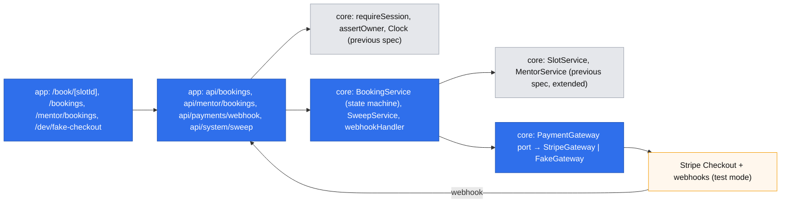
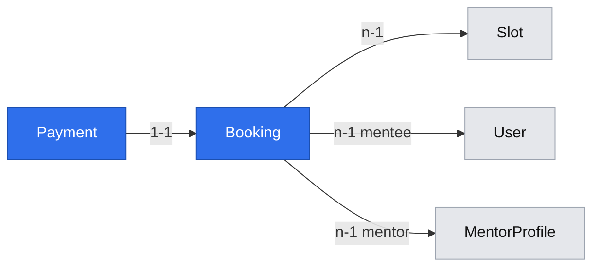

# Booking and prepayment

## 📝 TLDR
Future behavior: a signed-in developer opens a mentor (share link or public list), picks a bookable slot and a length, writes the question, pays by card through Stripe Checkout, and sees the booking awaiting the mentor; the mentor accepts or declines the question until 12 hours before the session, and a decline or a missed deadline refunds the mentee in full. Today mentors can publish an offer (spec `2026-10-19-mentor-accounts-and-offer.md`), but nothing can be booked or paid. This spec covers backlog #29, #30, #31, #32 (epic #22) and reuses that spec's sessions, ownership guards, `Clock`, `SlotService`, `Slot.status`, `MentorCard`/`SlotList`, the stack-tag filter and constants.

## 📝 Problem Statement
A developer who found a mentor still cannot reserve their time: there is no booking, no prepayment, and no way for the mentor to see the question before committing (Key flow steps 3–4; R01, R03, R05; D05, D07). Mentors asked to see the question first (D05, `[INTERVIEW]`), and mentors and mentees asked for opposite money protections (D04). So a booking must carry the question, take the money up front, and return it automatically whenever the mentor does not take the session.

## 📝 Proposed Solution
Two phases (see Phasing): a payment gateway behind a core port (#31), then booking, payment, acceptance and refunds together (#30, #32 and the *Book* action and entry-point recording of #29) — money enters the system only in the same release that can return it.

Gate decisions (owner Arkadiusz, 2026-10-19), recorded in the brief:
- **D13** — slots are bookable only from **24 h** ahead (supersedes D09), so the mentor always has ≥ 12 h to accept under R05.
- **D14** — the platform's Stripe account collects the full price; mentor payouts and Stripe Connect are a later spec (Q01, Q05 open).
- **D15** — mentors learn about bookings in the app only; email is a later spec.
- **D16** (from the reviews) — card payments only in this spec; BLIK and Przelewy24, which confirm later, are a separate decision.
- **Payment** — Stripe Checkout (hosted page), captured at once, confirmed by webhook; refunds through the API.
- **Hold** — a new booking holds its slot for 35 minutes while the mentee pays.
- **Deadlines** — read-time evaluation plus an idempotent, secret-protected sweep endpoint called every 5 minutes by an external scheduler.
- **The question** — plain text, ≤ 2,000 characters, no attachments, visible only to that mentee and that mentor.

Alternatives considered:
- **Embedded Payment Element** — lost: card UI on our pages, more code and PCI surface for no user gain.
- **Authorize at booking, capture on acceptance** — lost: card authorizations lapse after about 7 days and slots can be 60 days ahead.
- **In-process timer** for deadlines — lost: breaks with restarts and several instances. **Read-time only** — lost: a booking nobody opens would never be refunded.
- **Stripe Connect now** — lost: every mentor would onboard to Stripe before a first booking, which one interviewed mentor refused (Q05).

## 🔍 Research — what market leaders do
- **Cal.com (open source)** creates the booking first, then a Stripe payment; an unpaid booking is cancelled after a timeout, and webhooks move it on. Its "requires confirmation" events let the host confirm, and a rejection refunds. Kept: booking → payment → webhook, host confirmation (our R05), refund on reject. Skipped: payment apps per event type, rescheduling, seats.
- **Preply** confirms instantly and protects tutors with a 12-hour cancellation rule (our R04, a later spec). None of the benchmarks lets the expert decline the *question*; our mentors asked for it (D05).
- **Stripe's guidance** for Checkout: fulfil on webhooks, never on the success redirect; check `payment_status`; make fulfilment idempotent; use idempotency keys, which Stripe keeps for at least 24 hours — so reconcile by object state, not by key alone. Adopted.

## 📝 Architecture
New concepts: `bookings` and `payments`. Reused: `auth` guards, `Clock`, `SlotService`, `MentorService` (previous spec).

Takeaway: every money and state change happens in `BookingService`; Stripe sits behind a port, so tests and local development run without Stripe, and a future provider or Connect changes one adapter.

### Booking state machine
`BookingService` is the only place statuses change. Each transition runs in a transaction that locks the booking row (`PESSIMISTIC_WRITE`) and is a no-op when the booking is already past that state — webhooks and the sweep may repeat or race. Releasing a slot is always conditional: `slot.status = booked` **and** this booking is the slot's live booking; otherwise nothing is released.

| From | Event | To | Side effects |
|---|---|---|---|
| — | mentee books an open, bookable slot | `pending_payment` | slot `open → booked` (slot row lock); `holdExpiresAt = now + 35 min`; payment row `creating` |
| `pending_payment` | Checkout session created (after commit) | `pending_payment` | payment `creating → open`, `checkoutSessionId`, `url`; session `expires_at = holdExpiresAt − 1 min` (≥ 30 min after creation, Stripe's minimum) |
| `pending_payment` | session creation fails with a definite error | `payment_expired` | slot released; mentee sees `payment_unavailable` |
| `pending_payment` | webhook `checkout.session.completed` with `payment_status = paid` | `awaiting_acceptance` | payment `paid`, `paymentIntentId`; `acceptBy = slot.startsAt − 12 h` (R05) |
| `pending_payment` | hold expired — *expire protocol* below | `payment_expired` | slot released |
| `payment_expired` | late paid webhook | `payment_expired` | refund in full (payment was taken after the slot was released) |
| `awaiting_acceptance` | mentor accepts before `acceptBy` | `confirmed` | — |
| `awaiting_acceptance` | mentor declines | `declined` | refund requested; slot released (bookable again only if ≥ 24 h ahead) |
| `awaiting_acceptance` | `acceptBy` passed (sweep) | `expired` | refund requested; slot released |

Cancellation and no-show (R04) are the session spec's transitions out of `confirmed` (#34, #35).

**Expire protocol (fixes the hold-vs-payment race).** The sweep never releases a slot on time alone. For a `pending_payment` booking past `holdExpiresAt` it: (1) calls `expireCheckout(sessionId)` outside any transaction; (2) if Stripe reports the session already completed and paid, applies the *paid* transition instead; (3) only when the session is confirmed expired (or never created) does it lock the booking, re-check the status, mark `payment_expired` and release the slot. A paid webhook that arrives after step 3 hits the "late paid webhook" row and refunds.

**Recoverable Checkout creation.** The payment row is written as `creating` in the booking transaction with `idempotencyKey = checkout:{bookingId}`; session creation uses that key, so a retry after a lost response returns the same session. A booking whose payment stays `creating` for more than 2 minutes (crash between commit and the Stripe call) is retried once by the sweep with the same key; if that fails, the expire protocol releases it.

**Refund lifecycle.** A refund is requested with `idempotencyKey = refund:{bookingId}` and the payment moves `paid → refund_requested`. Stripe's `refund.updated` / `charge.refunded` webhooks move it to `refunded` or `refund_failed`. Before any retry the sweep lists the refunds of the payment intent and acts on their state — it never relies on the key alone (keys may be pruned after 24 h). `refund_failed` after three attempts is logged as an error for the founders and shown to the mentee as "Refund delayed — we are on it".

**Reads before the sweep.** `BookingService.effectiveStatus(booking, now)` reports `awaiting_acceptance` past `acceptBy` as `expired`, so screens and actions are right immediately (accepting after `acceptBy` → `conflict`). A slot held by an expired `pending_payment` booking stays unavailable until the next sweep — up to 5 minutes, an accepted lag, because releasing it safely needs the Stripe call in the expire protocol.

**PaymentGateway port** (`core/src/services/payments/payment-gateway.ts`): `createCheckout({ bookingId, amount, currency, description, successUrl, cancelUrl, expiresAt, idempotencyKey })` → `{ sessionId, url }`; `expireCheckout(sessionId)` → `{ state: "expired" | "paid", paymentIntentId? }`; `refund({ paymentIntentId, amount, idempotencyKey })`; `listRefunds(paymentIntentId)`; `parseWebhook(rawBody, signature)` → typed event or `ValidationError`. `StripeGateway` uses the `stripe` package with `payment_method_types: ["card"]` (D16), `client_reference_id = bookingId`, `metadata.bookingId` and `customer_email` = the mentee's email, so Stripe emails the payment and refund receipts (the mentee's only email in 1.0; D15 concerns mentors); the webhook handler looks the booking up by `checkoutSessionId` and rejects a mismatch of `bookingId`, amount or currency. `FakeGateway` keeps sessions in the database-free memory of the process and is selected by `PAYMENTS_PROVIDER=fake` (refused when `NODE_ENV=production`); its checkout page `/dev/fake-checkout/[sessionId]` lives in the app, renders *Pay* / *Cancel*, and posts a fake event signed with HMAC-SHA256 over the body using `SWEEP_SECRET`, which `FakeGateway.parseWebhook` verifies the same way `StripeGateway` verifies Stripe's signature.

**Webhook wrapper.** `POST /api/payments/webhook` cannot carry the CSRF header. Instead of a bypass flag, core gains `webhookHandler(verify, handler)`: it reads the raw body, calls `verify(rawBody, headers)` (the gateway's `parseWebhook`) and only then the handler; there is no other way to skip the CSRF check. It returns `200` for handled and ignored event types and `400` for a bad signature.

**Sweep.** `POST /api/system/sweep` (header `x-sweep-token` = `SWEEP_SECRET`, compared in constant time, plus the CSRF header) runs `SweepService`: retry `creating` payments, run the expire protocol on held bookings, expire unaccepted bookings, reconcile `refund_requested` / `refund_failed`. Each item in its own transaction, at most 100 per call. The scheduler is outside the app: a host cron line (`curl -X POST …` every 5 minutes) documented in README; tests call the sweep directly.

**Reused and extended from the previous spec:** `SlotService.assertBookable(slotId)` (open ∧ starts ≥ now + 24 h), `SlotService.release(slotId, bookingId)` (conditional), `MentorService.priceFor(mentorId, lengthMinutes)` (server-side price in grosze); the stack-tag filter on `/mentors` already exists there.

## 📝 Data Model
- **Booking** (new, `bookings`, concept `bookings`): `slot` → Slot (n-1), `mentee` → User (n-1), `mentor` → MentorProfile (n-1, denormalized for the mentor's list), `lengthMinutes` (25 | 50, R01), `priceAmount` (integer grosze, computed server-side when the booking is created and equal to the Checkout amount; a later price change never touches it — the #30 requirement), `currency` (`PLN`), `question` (text ≤ 2,000), `status` (`pending_payment | awaiting_acceptance | confirmed | declined | expired | payment_expired`), `holdExpiresAt`, `acceptBy` (nullable until paid), `entryPoint` (`link | list | unknown`, the A04 measurement), `decidedAt` (nullable), `declineReason` (nullable, ≤ 280, optional text from the mentor, shown to the mentee). The question is frozen once the booking is created — no edits. Indexes `(status, accept_by)`, `(status, hold_expires_at)`. Partial unique index on `slot_id` where `status in ('pending_payment', 'awaiting_acceptance', 'confirmed')` — the live states; written by hand in the migration.
- **Payment** (new, `payments`, concept `payments`): `booking` → Booking (1-1, unique), `provider` (`stripe | fake`), `status` (`creating | open | paid | expired | refund_requested | refunded | refund_failed`), `checkoutIdempotencyKey`, `checkoutSessionId` (unique, nullable while `creating`), `paymentIntentId` (unique, nullable until paid), `amount`, `currency`, `refundId` (nullable), `refundAttempts`, `paidAt`, `refundedAt`, `lastError` (provider message only).
- **Slot** (existing): no schema change; `booked` now means "held or taken by a live booking".

Interactive view (delivered with this spec): `.ai/data-model/2026-10-19-booking-and-prepayment.html`.

Sensitive data: no card data reaches DevMentor (Checkout). The question may contain a developer's code: it is returned only to that mentee and that mentor (`assertOwner` on either side; admins are not exempt) and never logged; Stripe receives only the amount, the currency, a generic description ("DevMentor session, 25 min") and the booking id.

## 📝 API Contracts
Envelope and CSRF as everywhere. Amounts in grosze.

| Method + path | Access | Body → result | Notes |
|---|---|---|---|
| `POST /api/bookings` | any session | `{ slotId, lengthMinutes, question, entryPoint }` → `{ bookingId, checkoutUrl }` (201) | price from `priceFor`, never from the client; slot locked; booking one's own slot → `forbidden` |
| `GET /api/bookings` | any session | `Page<BookingDto>` (own, as mentee) | effective status; optional `?status=` filter (Q13, owner decision 2026-10-20) |
| `GET /api/bookings/[id]` | the mentee or the mentor of that booking | `BookingDto` incl. question | otherwise `not_found` (does not reveal existence); `BookingDto` = `{ id, status (effective), paymentStatus, mentor: { name, slug }, startsAt, lengthMinutes, priceAmount, currency, acceptBy, declineReason, question }` — `paymentStatus` lets the page tell *refund on its way*, *Refunded* and *Refund delayed* apart (Q12, owner decision 2026-10-20); the mentee's own booking only |
| `GET /api/mentor/bookings` | mentor session | `Page<MentorBookingDto>` | awaiting first, ordered by `acceptBy`; the mentee appears by name only (no email); the page also carries `pendingCount` (all awaiting bookings, not just the first page) for the notice on `/mentor` (Q13); `MentorBookingDto` has no `paymentStatus` — the mentor never sees refund details (C68, Q14) |
| `POST /api/mentor/bookings/[id]/accept` · `/decline` | mentor (own) | decline: `{ reason? }` → `BookingDto` | after `acceptBy` → `conflict` "The acceptance deadline has passed" |
| `POST /api/payments/webhook` | provider signature (`webhookHandler`) | raw event → `{ received: true }` | idempotent; Stripe or fake by provider |
| `POST /api/system/sweep` | `x-sweep-token` | → `{ checkoutsRetried, holdsExpired, bookingsExpired, refundsReconciled, failed }` | idempotent, bounded |

`entryPoint`: the public list links to `/m/[slug]?from=list`; the mentor page keeps `from` on its *Book* links; `/book/[slotId]` sends it in the body (`link` when absent, `unknown` when tampered).

New error: `PaymentUnavailableError` (503, code `payment_unavailable`) — added to the `BACKWARD_COMPATIBILITY.md` error-code registry (additive). New env (additive; `env.ts`, `.env.example`, README, CI and integration setup in the same PR): `PAYMENTS_PROVIDER`, `STRIPE_SECRET_KEY`, `STRIPE_WEBHOOK_SECRET` (required when the provider is `stripe`), `SWEEP_SECRET` (≥ 32 chars), `APP_URL` (success and cancel URLs).

## 📝 UI/UX
- **Mentor page `/m/[slug]`** (previous spec): each bookable slot gets *Book 25 min · {price}* and *Book 50 min · {price}*.
- **`/book/[slotId]?length=…`**: a summary (mentor, local date and time with zone, length, price), the question box with a counter, a note that the mentor sees the question and may decline it (refund in full), and "Card payment". An anonymous visitor goes to `/login?next=…` (or *Register*) and comes back. *Pay* opens Checkout.
- **`/bookings/[id]`**: Checkout returns here. *Payment processing…* until the webhook lands (re-checks every few seconds for up to a minute, then "This page will update shortly"); then *Waiting for {mentor} — they decide by {acceptBy}*; *Confirmed*; *Declined — refund on its way*; *Expired — refund on its way*; *Refunded*; *Refund delayed — we are on it*; *Payment not completed — the time was released*. Refund wording says banks take a few days.
- **`/bookings`**: own bookings by status.
- **`/mentor/bookings`** and a *Pending* item on `/mentor`: each awaiting booking shows the question, the slot and a countdown to `acceptBy`, with *Accept* and *Decline* (confirm step: "The mentee gets a full refund", with an optional reason up to 280 characters that the mentee sees).

## 📝 Edge Cases & Failure Scenarios
- **Two mentees, one slot:** the slot row lock plus the partial unique index let exactly one booking through; the other gets `conflict` "This time was just taken".
- **Stripe unavailable or crash at Checkout creation:** see *Recoverable Checkout creation*; the mentee sees `payment_unavailable` and can retry; no charge happened.
- **Mentee abandons Checkout:** the session expires; the next sweep releases the slot (≤ 5 minutes after the hold).
- **Paid while the sweep expires the hold:** the expire protocol checks Stripe first; a payment completed in between is honoured, and one completed after the release is refunded.
- **Completed webhook without `payment_status = paid`:** ignored (cannot happen with cards only; logged if it does).
- **Webhook twice, out of order, or for an unknown session:** idempotent transitions; unknown sessions and event types → `200`, logged; amount or currency mismatch → logged as an error, no transition.
- **Webhook never arrives:** the expire protocol asks Stripe directly, so a paid session is still recognised.
- **Refund fails or stays pending:** see *Refund lifecycle*.
- **Accept and decline at once (two tabs):** the booking row lock serializes them; the second gets `conflict`.
- **Accept at the deadline:** `now ≥ acceptBy` → `conflict`, even before the sweep.
- **Booking one's own slot:** `forbidden`; a mentor may book other mentors.
- **Slot hoarding:** a mentee may have at most 2 bookings in `pending_payment` at once; a third → `conflict` "Finish or abandon your previous payment first". Paid bookings are not limited.
- **Refund amount:** always 100% of `priceAmount` (R05); Stripe's fee on a refunded payment is a platform cost, to be priced into the commission (Q01).
- **After acceptance:** the mentor can no longer decline; any withdrawal by either side is a cancellation under R04 (#34). A mentee cannot cancel while the booking awaits acceptance in this spec — that also belongs to #34, so R04 lives in one place.
- **Sweep not scheduled:** reads stay correct, but refunds and releases wait; README states the cron line is required in any deployed environment, and the sweep response counts `failed`.

## 📝 Risks & Impact Review
- **Money (risk-high):** prepayments and refunds; QA and a second reviewer required, no self-QA. Test mode only and **not launchable** until Q01 (commission) and the payout spec exist — collected money sits on the platform account (D14).
- **Hard to reverse:** `bookings` and `payments` tables, the partial unique index, the `payment_unavailable` code, the webhook URL registered in Stripe.
- **Shared primitive:** `webhookHandler` is the only CSRF exception and always verifies a signature first; unit tests prove an unverified body never reaches the handler.
- **Operational dependency:** an external scheduler must call the sweep.
- **Product limitations:** prices are shown and charged as gross amounts; invoices and tax handling are out of scope and tied to brief Q06. Nearest bookable slot ≥ 24 h away (D13); in-app notice only (D15); cards only (D16) — BLIK is common in Poland, so card-only may cost bookings; measured by abandoned Checkouts.
- **Dependency:** `stripe` (official SDK) in `@devmentor/core`.

## 📝 Decisions in play
Relied on: R01, R03, R05, R07 (commission open — Q01), R08, D02, D03, D05, D07, D08, D10–D12, N02, N03. Introduced here (owner Arkadiusz): **D13** (supersedes D09), **D14**, **D15**, **D16** — in `product-brief.md` and `research/decisions/`. Owned by later specs: cancellation and no-show (R04, #34, #35), payouts and commission (Q01, Q05), email (D15), BLIK/Przelewy24 (D16).

## 🔍 Review decisions
Owner decisions on the reviews, 2026-10-19:
- **Grill Me** (after both reviews): 9 questions, all recommendations accepted — at most 2 unpaid bookings per mentee, an optional decline reason, the question frozen after booking, the mentee shown to the mentor by name only, refunds always 100% (fees are a platform cost, Q01), Stripe receipt emails for mentees, cancellation before acceptance and any withdrawal after acceptance left to R04 (#34), gross prices with invoicing tied to Q06.
- **Scope-cohesion review** (fresh-context subagent): *revise*. Accepted: Stripe's 30-minute session minimum (hold 35 min, session ends a minute earlier); phases 2 and 3 merged so money never enters without refunds; integration tests seed past deadlines instead of a fake clock; card-only to avoid delayed confirmations; the ≤ 5-minute release lag documented; the duplicate filter phase removed and `entryPoint` routing specified; payment-row lifecycle, booking lookup and amount checks defined; fake checkout specified; `SWEEP_SECRET` in Phase 1; any session may book; price stored at booking.
- **Cross-model review** (Codex, GPT): *revise*. Accepted: the expire protocol for the hold-vs-payment race and conditional slot release; recoverable Checkout creation with a stable idempotency key; the refund lifecycle with reconciliation instead of trusting keys; `webhookHandler` instead of a CSRF bypass flag; delayed-payment events (answered by D16). Corrected: the claim that the unique index covers `payment_expired` — it lists only the three live states. Rejected: "move research and the phase plan out of the spec", for the same reasons as in the previous spec (the research section is part of the `om-spec-writing` format; the plan is what `om-auto-create-pr` executes).

## 📋 Phasing
1. **Payment gateway** (#31) — port, Stripe and fake adapters, `webhookHandler`, env; no user-visible change, fully unit-tested.
2. **Booking, payment, acceptance and refunds** (#30, #32, rest of #29) — depends on 1; ships the whole money loop at once.

## 📋 Implementation Plan

### Phase 1 — Payment gateway (#31)
1. Env: `PAYMENTS_PROVIDER`, `STRIPE_SECRET_KEY`, `STRIPE_WEBHOOK_SECRET`, `SWEEP_SECRET`, `APP_URL` in `env.ts` (conditional requirements, `fake` refused in production), `.env.example`, README, CI; redaction of `STRIPE_*` and `SWEEP_SECRET`.
2. `PaymentGateway` port, `FakeGateway` (HMAC-signed events), `StripeGateway` (`stripe` SDK, card only, mocked client in unit tests), container registration by provider; `webhookHandler`; `PaymentUnavailableError` + registry update. 100% coverage.

### Phase 2 — Booking, payment, acceptance and refunds (#30, #32, #29)
1. `Booking`, `Payment` entities + migration with the hand-written partial unique index (reviewed SQL).
2. `SlotService.assertBookable`, conditional `SlotService.release`, `MentorService.priceFor`; `BookingService.create` (slot lock, price, hold, `creating` payment) and Checkout creation after commit.
3. Webhook route; paid / late-paid / refund transitions; `effectiveStatus`; accept / decline / expire; refund requests and reconciliation. Unit tests for every row of the state machine, repeats and races (concurrent webhook and sweep simulated with mocked gateway responses).
4. `SweepService` and `/api/system/sweep` (Checkout retry, expire protocol, acceptance expiry, refund reconciliation).
5. Pages `/book/[slotId]`, `/bookings`, `/bookings/[id]`, `/mentor/bookings`, the *Pending* item on `/mentor`, *Book* buttons with `from`; `/dev/fake-checkout/[sessionId]`.
6. Integration tests (fake provider): book → pay → *Waiting* → mentor accepts → *Confirmed*; another declined → refunded, slot bookable again; a seeded booking with `acceptBy` in the past → sweep → *Expired*; abandoned Checkout → sweep → slot released; two parallel bookings → one wins; a booking from the list records `list`. Screenshots.

Done for the spec: both phases merged; lint, typecheck, `test:coverage` (100%), build and integration tests green; #29–#32 closed on the fake-gateway evidence above (integration suite with the fake provider). A manual run against Stripe test mode with the Stripe CLI forwarding webhooks (real-run evidence, review rule R4) is a precondition before launch, not part of this epic's close; the owner records it in the launch checklist.
