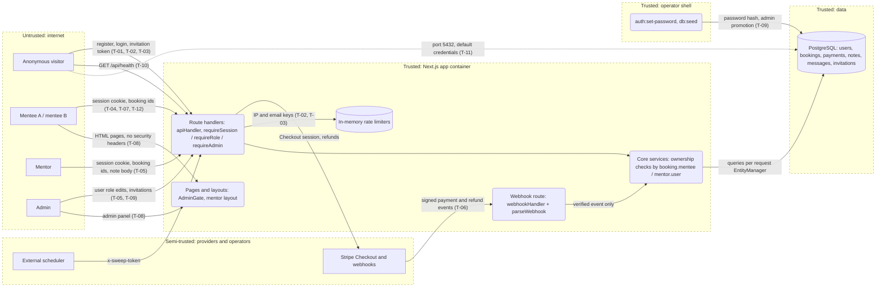

# Threat model: DevMentor

**Scope:** whole system (`@devmentor/app` with `core` and `db`; `ui` is presentation only and has no model of its own)
**Last updated:** 2026-11-04
**Owner:** Arkadiusz Garzel

DevMentor is a mentoring marketplace: mentees book and prepay sessions with mentors (Stripe Checkout), both sides exchange messages and a post-session note, and admins manage users and mentor invitations. Object-level access is decided in the core services, not in the routes, which works today but is the place where one forgotten check leaks another mentee's booking (T-04). The cheapest real attacks are on the public auth endpoints: unlimited mentee registration (T-01) and an email-only login lockout that anyone can trigger against a victim (T-02).

## 1. What are we working on?

### System profile

| Application | Type | Stack | Deployed as | Auth | Tenancy | AI |
| --- | --- | --- | --- | --- | --- | --- |
| `@devmentor/app` (+ `core`, `db`) | Browser web app + JSON API (route handlers) | Next.js 16 App Router, React 19, Awilix, MikroORM 7, PostgreSQL 17 | One Docker container (`Dockerfile`, standalone output, `NODE_ENV=production`) next to a Postgres container (`docker-compose.yml`) | Stateless HS256 JWT in `devmentor_session` cookie (`httpOnly`, `sameSite=lax`, `secure` in production), 24 h, no refresh, no revocation; user reloaded on every request (`AuthService.authenticate`) | None (single marketplace). Roles `mentee`, `mentor`, `admin`; ownership by `booking.mentee` / `booking.mentor.user` | None at runtime |
| Operator CLI (`auth:set-password`, `db:seed`) | CLI | Node scripts in `core/src/cli` | Operator shell with `DATABASE_URL` | Shell access to the host | n/a | None |

Architecture: modular monolith; route handler → `createRequestScope()` → service → per-request `EntityManager` → Postgres. No queue or worker; a host cron calls `POST /api/system/sweep`.
Data stores: Postgres (users with bcrypt hashes, mentor profiles, slots, bookings, payments, notes, messages, invitation token hashes); in-memory, per-process rate limiters (`core/src/rate-limiter.ts`).
External systems: Stripe (Checkout, refunds, webhooks); a fake gateway for development and tests (`PAYMENTS_PROVIDER=fake`).
Existing cross-cutting controls: CSRF header `x-devmentor-client` on every state-changing method (`core/src/http/apiHandler.ts:35-37`) plus `sameSite=lax`; the webhook route is the only exception and verifies the signature first (`core/src/http/webhookHandler.ts:10-35`); Zod validation on all bodies; generic 500 without stack traces (`apiHandler.ts:50-55`).

### Assets (what we protect)

- User accounts, password hashes and session tokens (`AUTH_SECRET`)
- Bookings, payments and refunds (money moves on booking state changes)
- Private session content: messages and the mentor's note
- Admin capability: role changes, mentor invitations (an invitation grants the mentor role)
- Secrets: `AUTH_SECRET`, `STRIPE_SECRET_KEY`, `STRIPE_WEBHOOK_SECRET`, `SWEEP_SECRET`, `DATABASE_URL`
- Mentor availability (a held slot cannot be booked by anyone else)

### Actors

| Actor | Access | Motivation |
| --- | --- | --- |
| Anonymous internet user | Public pages, register, login, invitation preview, `/api/mentors`, `/api/health`, webhook URL | Account abuse, lock out users, enumerate emails, forge payment events |
| Logged-in mentee B | Own bookings | Read or change mentee A's booking, messages or note |
| Logged-in mentor | Own slots, own bookings as mentor; may also book other mentors as a mentee | Act as the mentee of own booking (refund, approve note), reach admin |
| Logged-in non-admin | Standard features | Reach `/api/users` or `/api/admin/*` |
| Malicious or careless admin | Full user CRUD, invitations | Silent role changes with no trace |
| Network neighbour of the host | Published container ports | Direct Postgres access |
| Compromised dependency | Build or runtime | Out of scope here (see Test scope) |

### Entry points

| Entry point | Auth required | Notes |
| --- | --- | --- |
| `POST /api/auth/register` | none | Always creates a mentee; no rate limit |
| `POST /api/auth/login` | none | 5 failures per email / 15 min |
| `POST /api/auth/register/mentor`, `POST /api/auth/invitations/preview` | none (invitation token in body) | Rate limited per client IP |
| `POST /api/auth/logout` | none | Deletes the cookie only |
| `GET /api/mentors`, `GET /api/mentors/[slug]` | none | Public DTOs without email or user id |
| `GET /api/health` | none | DB reachability |
| `POST /api/payments/webhook` | provider signature | No session, no CSRF header |
| `POST /api/system/sweep` | `x-sweep-token` = `SWEEP_SECRET` | Constant-time compare (`core/src/http/sweep-auth.ts:14-18`) |
| `GET/POST /api/bookings`, `GET /api/bookings/[id]`, `POST …/cancel`, `GET …/note`, `POST …/note/approve`, `GET/POST …/messages` | any session | Ownership decided in services |
| `/api/mentor/*` (profile, slots, bookings, accept, decline, note) | session + role `mentor` | Own records resolved from the session |
| `/api/users`, `/api/users/[id]`, `/api/admin/invitations` | admin | `makeCrudRoute` access guard / `requireAdmin` |
| `POST /api/dev/fake-checkout/[sessionId]` | any session | 404 unless `PAYMENTS_PROVIDER=fake` |

### Data flow and trust boundaries

Boundaries: browser ↔ app; Stripe ↔ webhook route; scheduler ↔ sweep route; app ↔ Postgres; operator shell ↔ Postgres.
Diagram source: `docs/security/threat-model.mmd` (not rendered; render with `npx @mermaid-js/mermaid-cli -i docs/security/threat-model.mmd -o docs/security/threat-model.svg` where mermaid-cli is already available).

### AI components

None at runtime: no model output influences application behaviour. Rule of Two: not applicable. Re-run this model when a chatbot, an agent or an LLM-based feature is added.

OWASP lists in scope: Web Top 10:2025 and API Security Top 10:2023 (a JSON API behind the pages). Not in scope today: GenAI LLM Top 10, Agentic Applications Top 10 and MCP Top 10 (no LLM, agent or MCP server in the product). The Agentic Skills Top 10 applies to the development harness (`.agents/skills/`, third-party skills such as `threat-model`), not to the product.

### Assumptions and open questions

- [ ] Production topology is not in the repo: is there a reverse proxy in front of port 3000, does it overwrite `X-Forwarded-For` / `X-Real-IP`, and where is TLS terminated? T-03 and the `secure` cookie depend on it.
- [ ] Is port 5432 published on any non-local host (`docker-compose.yml` publishes it with default credentials)? (T-11)
- [ ] One app instance only? The limiters are in-memory per process; a second instance doubles every limit and a restart clears them.
- [ ] Does every non-local environment (staging, demo) run with `NODE_ENV=production`? The fake provider is refused only on that value (`core/src/config/env.ts:21-23`). (T-06)
- [ ] The invitation link origin comes from `new URL(req.url).origin` (`app/src/app/api/admin/invitations/route.ts:18`); how the deployed proxy sets `Host` is unknown.
- [ ] Log content and retention (pino) were not reviewed for personal data beyond the webhook and booking transition logs.

## 2. What can go wrong?

| ID | Threat | STRIDE | Where | L | I | Response | Control today | How we verify | OWASP / CWE |
| --- | --- | --- | --- | --- | --- | --- | --- | --- | --- |
| T-01 | Anonymous script creates mentee accounts without limit (spam accounts, bcrypt CPU cost 12 per request, fuel for T-12); the 409 on a taken email confirms which addresses have accounts. Spec asks for 10 accounts per IP per hour on both registration paths (`.ai/specs/implemented/2026-10-19-mentor-accounts-and-offer.md:137`) | S, D, I | `app/src/app/api/auth/register/route.ts:6-15`; `core/src/services/auth/auth.service.ts:41-44`, `:136-145` | H | M | Mitigate: per-IP registration limiter like `InvitationService.guardRegistration`; consider a neutral response for a taken email | None: route calls `authService.register` with no limiter | Integration test: 11th registration from one IP in an hour → 429; unit test on the guard | API4:2023, API6:2023, A07:2025, CWE-799, CWE-204 |
| T-02 | Anyone locks a known user out for 15 min by sending 5 wrong passwords for their email; no per-IP cap, so password spraying across many emails is unlimited. Spec: key = IP + email | D, S | `core/src/services/auth/auth.service.ts:14`, `:55-64`; `core/src/container/container.ts:44` | H | M | Mitigate: key the lockout on IP + email as specified, add a separate per-IP cap across emails | Partial: `rateLimiter` keyed by normalized email only | Integration test: 5 failures from IP X, then a correct login from IP Y succeeds; many emails from one IP → 429 | A07:2025, API2:2023, CWE-307, CWE-645 |
| T-03 | Client IP is read from the first `X-Forwarded-For` hop; the app port is published directly, so rotating the header bypasses the invitation preview and mentor registration limits; without the header every client shares the key `unknown`, so one attacker blocks mentor registration for everyone for an hour | S, D | `app/src/lib/client-ip.ts:5-8`; `core/src/services/mentors/invitation.service.ts:11-13`, `:61-70` | M | M | Mitigate: trust the forwarded header only from the known proxy (or take the proxy's appended hop), document the deployment | Partial: limits exist, IP source spoofable (acknowledged in the spec, line 63) | Unit test on `clientIp` with a trusted-proxy setting; DAST probe with varying header in the isolated env | API4:2023, A07:2025, CWE-348, CWE-770 |
| T-04 | Same role: mentee B reads, cancels (triggering a refund decision), approves or rejects the note of, or reads/writes messages on mentee A's booking by swapping the id in `/api/bookings/{id}/…`. Routes only `requireSession`; since PR #98 the cancel and note routes no longer `requireRole("mentee")`, so the service check is the only line | I, T, E | `app/src/app/api/bookings/[id]/route.ts:4-8`, `cancel/route.ts:6-12`, `note/route.ts:5-9`, `note/approve/route.ts:6-11`, `messages/route.ts:5-16` | M | H | Mitigate (keep): service-level ownership, 404 for foreign ids; add a regression test per route | Yes: `BookingQueryService.getForMentee` (`booking-query.service.ts:67-71`), `BookingTransitions.cancelByMentee` (`booking-transitions.service.ts:179-181`), `SessionNoteService.loadBooking` (`session-note.service.ts:101-106`), `SessionThreadService.loadBookingForParticipant` (`session-thread.service.ts:42-47`) | Integration tests with two seeded mentees: B gets 404 on GET, cancel, note, approve and messages of A's booking (GET and messages covered by `booking-404.int.test.ts`, `session-thread-access.int.test.ts`; cancel, note, approve by another mentee not yet) | A01:2025, API1:2023, CWE-639 |
| T-05 | Cross role: the booking's mentor calls the mentee endpoints on that booking (cancels to force a refund, approves their own note); a mentee calls `/api/mentor/*`; a non-admin calls `/api/users/[id]` with `role: "admin"` | E | `app/src/app/api/bookings/[id]/*`; `app/src/app/api/mentor/**/route.ts`; `app/src/app/api/users/users.crud.ts` | L | H | Mitigate (keep): role-specific service checks and route guards | Yes: `loadBooking(..., "mentee")` compares `booking.mentee.id`; `requireRole(session, "mentor")` in every mentor route; `makeCrudRoute` `accessGuards.admin` → `requireAdmin` (`core/src/http/makeCrudRoute.ts:22-24`, `auth.ts:30-34`); `AdminGate` in `app/src/app/admin/layout.tsx` | `mentor-booking-mentor.int.test.ts:61-64`; add: mentee session → 403 on `/api/mentor/slots` and `PUT /api/users/{id}` | A01:2025, API5:2023, CWE-285, CWE-862 |
| T-06 | Forged or replayed payment webhook marks an unpaid booking as paid; or the fake gateway (HMAC with `SWEEP_SECRET`, any signed-in user can "pay" via `/api/dev/fake-checkout/*`) runs in a non-local environment whose `NODE_ENV` is not `production` | S, T | `app/src/app/api/payments/webhook/route.ts:5-8`; `core/src/payments/stripe.gateway.ts:95-104`; `core/src/payments/fake.gateway.ts:83-85`, `:100-109`; `core/src/config/env.ts:21-23` | L | H | Mitigate (keep) + accept the dev-only fake with an env check; optionally use a dedicated fake webhook secret | Yes: Stripe `constructEvent` signature and timestamp; fake HMAC with `timingSafeEqual`; event cross-checked against the stored payment (`booking-transitions.service.ts:120`); fake refused when `NODE_ENV=production` | `stripe.gateway.test.ts:100`; `booking-webhook-replay.int.test.ts`; integration test: unsigned and wrongly signed POST → 400, booking unchanged; deployment checklist asserts `PAYMENTS_PROVIDER=stripe` | A08:2025, API10:2023, CWE-345, CWE-347 |
| T-07 | A stolen session cookie (shared computer, proxy log) stays valid for up to 24 h; logout only deletes the cookie in that browser and a password reset does not revoke tokens | S | `app/src/app/api/auth/logout/route.ts:5-8`; `core/src/http/session-cookie.ts:5`; `core/src/services/auth/auth.service.ts:97-127` | M | H | Mitigate: token version or `passwordChangedAt` on `User` checked in `authenticate`; shorter lifetime | Partial: `httpOnly`, `sameSite=lax`, `secure` in production; user reloaded per request (deletion and role change apply at once) | Integration test: token captured before logout or password reset → 401 afterwards | A07:2025, API2:2023, CWE-613 |
| T-08 | No security headers: pages can be framed (clickjacking of admin invitations, mentor accept/decline), no CSP as a second line against XSS in user content (messages, notes, bios), no `nosniff`, no HSTS, no explicit `Referrer-Policy` for the invitation link token in the URL | T, I | `app/next.config.ts` (no `headers()`); no `proxy.ts` / `middleware.ts` in `app/src` | M | M | Mitigate: `headers()` in `next.config.ts` with `frame-ancestors 'none'`, CSP, `X-Content-Type-Options: nosniff`, HSTS, `Referrer-Policy` | None (React escaping only; no `dangerouslySetInnerHTML` found) | DAST header check on `/`, `/admin`, `/mentor`, `/register/mentor`; integration test asserting the headers | A02:2025, API8:2023, CWE-1021, CWE-693 |
| T-09 | An admin promotes a user to admin, changes roles or deletes users, or an operator runs `auth:set-password --admin`, and nothing records who did it and when | R | `core/src/services/auth/user.service.ts:44-48`; `app/src/app/api/admin/invitations/route.ts:12-21`; `core/src/services/auth/auth.service.ts:76-94` | L | M | Mitigate: structured audit log (actor, action, target, time) for role changes, user deletes, invitations, admin password resets; also failed logins | None: only booking transitions, sweep and health log | Review logs after each admin action in the isolated env; unit test that the service emits the audit entry | A09:2025, CWE-778 |
| T-10 | `/api/health` is anonymous and runs `select 1` per call without a limit; it reveals only `status` and `database` reachability | I, D | `app/src/app/api/health/route.ts:4-11`; `core/src/services/system/health.service.ts:9-17` | L | L | Accept: output is minimal, errors are logged not returned; revisit if it grows | Yes: response `{ status, database }` only | DAST: anonymous GET returns no versions, hosts or error text | A02:2025, API8:2023, CWE-200 |
| T-11 | Postgres is published on `5432` with default credentials `devmentor/devmentor` when `.env` does not override them; anyone on the network reads or changes every table, including password hashes and payments | I, T, E | `docker-compose.yml` (service `db`: `ports`, `POSTGRES_PASSWORD` default) | M | H | Mitigate: do not publish 5432 outside local development (bind to `127.0.0.1` or drop it), no default password | None | Config review / port scan of the deployed host in the isolated env; CI check that compose binds DB to localhost | A02:2025, CWE-1392, CWE-284 |
| T-12 | Slot hoarding: each mentee account may hold 2 unpaid bookings for 35 min; with throwaway accounts from T-01 an attacker keeps a mentor's calendar blocked without paying | D | `core/src/services/bookings/booking.service.ts:13-15`, `:46-56` | M | M | Mitigate: fix T-01 first; optionally a per-mentor cap on concurrent holds or a shorter hold | Partial: `MAX_PENDING_PAYMENT_BOOKINGS = 2` per mentee, holds expire via sweep | Integration test: third pending booking → 409; after T-01, scripted registrations hit 429 | API6:2023, A06:2025, CWE-799 |
| T-13 | Login and registration fields, password included, leave in the URL (`GET /login?email=…&password=…`) when the form is submitted before hydration or with JS off, and end up in browser history, server/proxy logs and `Referer` | I | `ui/src/backend/forms/CrudForm.tsx` (form without `method`) | M | H | Mitigated 2026-11-04: `method="post"` | Yes: `method="post"` on `CrudForm`; found by the ZAP baseline scan | `CrudForm.test.tsx` asserts `method="post"`; ZAP baseline shows no "Sensitive information in URL" | A04:2025, CWE-598 |

## 3. Test scope

| Method | What to try | Threats |
| --- | --- | --- |
| Integration tests | 11th mentee registration per IP → 429; lockout by IP + email; mentee B → 404 on cancel, note, approve, messages of A's booking; mentee → 403 on mentor and admin routes; unsigned/wrong-signature webhook → 400 and booking unchanged; token invalid after logout/password reset; security headers present; third pending booking → 409 | T-01, T-02, T-04, T-05, T-06, T-07, T-08, T-12 |
| Unit tests | `clientIp` trusted-proxy behaviour; audit entries emitted by admin services | T-03, T-09 |
| SAST / review | Every new `api/**/route.ts` calls `requireSession` and passes `session.id` to a service that scopes by owner; `docker-compose.yml` port bindings | T-04, T-05, T-11 |
| DAST (no session, then mentee A's session) | Header check on main pages; `/api/health` output; varying `X-Forwarded-For` against the invitation endpoints | T-03, T-08, T-10 |
| Manual, two accounts | Mentee A and mentee B, plus a mentor who also books another mentor: swap booking ids across all `/api/bookings/[id]/*` routes | T-04, T-05 |
| Prompt injection | Not applicable (no AI components) | - |

**Out of scope:** Stripe and hosting provider infrastructure, volumetric DoS, social engineering, dependency supply chain (covered by CI and lockfile review), production and any shared environment.

**Rules of engagement:** local Docker stack or a disposable environment only; `PAYMENTS_PROVIDER=fake` or Stripe test mode; synthetic data only (`npm run db:seed` plus extra seeded mentees and mentors); never against real accounts, real payments or the production database.

## 4. Did we do a good job?

- [x] Every application in scope has a row in the System profile
- [x] Every entry point and every boundary crossing on the diagram was walked through all six STRIDE letters
- [x] Every AI component has a Rule of Two verdict (none exist)
- [x] Every High threat has a mitigation and a verification
- [x] Cross-tenant and cross-role threats are present (single tenant; same-role T-04, cross-role T-05)
- [x] Threat IDs are annotated on the diagram's flows
- [x] Assumptions are marked, not presented as facts
- [x] The document contains no attack instructions, payloads or exploit code
- [x] Out of scope and rules of engagement are written down

## Changelog

- 2026-11-04 Initial model (lesson 16)
- 2026-11-04 T-13 added from the ZAP baseline scan and mitigated (`CrudForm` posts natively); ZAP confirmed T-08 (no CSP, no anti-clickjacking, `X-Powered-By`, no `nosniff`)
